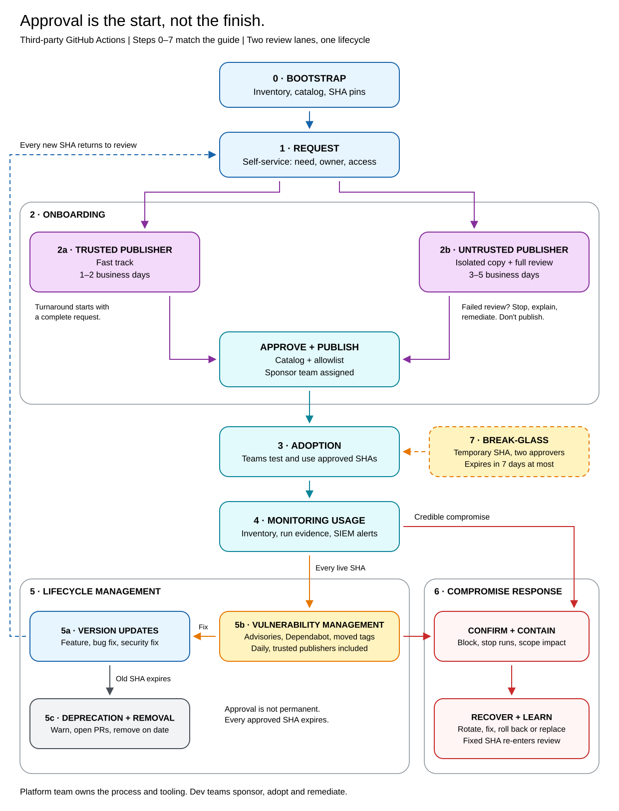

<!-- _class: lead -->
<!-- _paginate: false -->
<!-- _footer: "" -->

# Securing Third-Party GitHub Actions at Scale

**Principles, then practice**

Onboard, adopt and monitor them without slowing teams down

**Cloud Solution Architect · Microsoft**
<span style="font-size:18px;color:#656d76">Personal views, not official Microsoft guidance</span>

<!--
Time: 0:30. Elapsed: 0:30.
This is the deck the site links to. The original deck is still published at /slides/.
The talk has two separate parts. First explain the general framework without the Contoso story. Then show Contoso applying it step by step, naming the Part 1 principles at each step.
Presentation: 27 minutes. Questions: 3 minutes. Backup slides are outside that time.
-->

---

# Two parts. One clear route.

<div class="cols">
<div class="route">

### Part 1 · Principles

**The framework, for any organization**

- Approve what runs.
- Limit what it can reach.
- Keep managing it.

Make the secure path the fastest path.

</div>
<div class="route">

### Part 2 · Practice

**Contoso applies the framework**

- Meet Contoso, and its bad day.
- Map the new workflow, steps 0–7.
- Walk each step, principle by principle.

A fictional story with concrete decisions.

</div>
</div>

<!--
Time: 0:30. Elapsed: 1:00.
Three minutes of context, nine on principles, thirteen on practice, two to bring it back to the audience, then questions.
The guide uses the same two-part structure. The complete settings checklist is in backup, not a third section in the middle of the story.
-->

---

# Every `uses:` line is someone else's code

It runs next to **your source code, your token and your secrets**.

<div class="cards">
<div>

### The reference

**Tags can move.**

**March 2025:**

`tj-actions/changed-files`

An attacker moved its version tags to malicious code.

</div>
<div>

### The execution

**The entry point isn't all the code.**

Nested actions, bundles, hooks, images and downloaded tools run too.

</div>
<div>

### The access

**A pin isn't a sandbox.**

Malicious code can use whatever the job and runner make available.

</div>
</div>

<div class="takeaway">Control the code, its access and what happens after approval.</div>

<!--
Time: 2:00. Elapsed: 3:00.
Public record: CVE-2025-30066 / GHSA-mw4p-6x4p-x5m5. The payload read runner memory and printed secrets, double base64-encoded, into workflow logs. More than 23,000 repositories used the action; that is not a count of confirmed secret leaks.
Third-party means outside your enterprise, including GitHub's actions/*, Microsoft and Azure actions.
The March 2026 Trivy incident is another example: an older pinned commit loaded a nested action by tag. Use that only as a brief illustration of the execution column, not a second incident story.
Out of scope: building internal actions, general workflow hardening and runner platform design.
-->

---

<!-- _class: lead -->
<!-- _footer: "Part 1 · Principles" -->

# Part 1 · Principles

The framework, before the story

<div class="route">Approve what runs → Limit its access → Keep managing it</div>

<!--
Time: 0:15. Elapsed: 3:15.
No Contoso story in this part. These are the ten principles from the guide, grouped for the talk. They follow the same order as the guide.
-->

---

<p class="section-label">Part 1 · Principles</p>

# Make the secure path the fastest path

| Team | Its part of the secure path |
|---|---|
| **Platform** | Runs the process, catalog, checks and policy |
| **Dev teams** | Sponsor requests, test, adopt and migrate |
| **Security** | Watches what runs; joins risky requests and incidents |
| **Infra team** | Runs the runners and owns their egress rules |

<div class="impl"><p class="impl-h">Implementation details</p><ul>
<li>A self-service tool to search the catalog and request third-party GitHub Actions</li>
<li>Published turnaround times: 1–2 / 3–5 business days</li>
<li>Every policy failure links to the catalog and the request form</li>
</ul></div>

<div class="takeaway">If the approved route is slower than a workaround, people take the workaround.</div>

<!--
Time: 1:45. Elapsed: 5:00.
This principle underpins all three groups on the next slides.
The requesting dev team is the sponsor: it shares responsibility for review, testing and keeping the action current. Other consuming teams must use it within its limits and migrate on time.
This is a self-service product, not a security ticket queue. GitHub issue forms, a developer portal like Backstage or an existing ITSM tool can provide the front door. Developers search the catalog, request what's missing, get a decision and copy the approved snippet.
Point at the green box, don't read it. Automate every check that doesn't need a human. The full settings checklist is in backup.
The two turnaround times come from two onboarding routes: 1–2 business days for trusted publishers, 3–5 for everyone else. The next slide explains them.
-->

---

<style scoped>
.route code { white-space: nowrap; }
.route { margin-top: 4px; padding: 12px 20px; }
.route li { margin-bottom: 2px; }
</style>

<p class="section-label">Part 1 · Principles · Approve what runs</p>

# Two doors: trusted publishers and everyone else

<div class="cols">
<div class="route">

### Trusted publishers

- A **short list you choose**, never individuals.
- Allow the repository: `owner/repo@*`
- **Fast track:** 1–2 business days.
- **The price:** future SHAs run without review.

</div>
<div class="route">

### Everyone else

- Any other publisher, verified badge or not.
- Allow one SHA: `owner/repo@<full-sha>`
- **Full review:** 3–5 business days.
- **Every new version** is reviewed again.

</div>
</div>

<div class="impl"><p class="impl-h">Implementation details</p><ul>
<li>A short, written list of trusted publishers, reviewed twice a year</li>
<li>Allowlist trusted publishers per repository, never <code>owner/*</code></li>
</ul></div>

<div class="takeaway">Trust a few publishers for speed. Balance it with pinning, daily monitoring and a fast block.</div>

<!--
Time: 1:00. Elapsed: 6:00.
This is the one deliberate exception to "only run what you've approved, at exact SHAs". It's what makes the fast path possible for the actions teams use most.
Allowing owner/repo@* saves review work and allowlist entries, but it lets in future SHAs nobody reviewed. Accept that only for a short list of organizations.
Pick the publishers you already depend on most. Good criteria: a verified identity, a security policy, enforced 2FA, and protected tags or immutable releases. Review the list twice a year.
Allow trusted publishers per repository, not with owner/*, which trusts repositories that don't exist yet. The "Allow actions created by GitHub" checkbox also covers archived repositories.
A Marketplace verified-creator badge tells you who published an action, not that it's safe. It isn't a reason to trust a publisher.
Trusted doesn't mean unwatched: SHA pinning still applies, daily monitoring covers these repositories too, and one deny entry blocks a bad SHA or the whole repository.
In Part 2, the Infra team's azure/login request takes the fast track and Fabrikam's action gets the full review.
-->

---

<p class="section-label">Part 1 · Principles · Approve what runs</p>

# Approve the code, not the badge

<div class="cards">
<div>

### Only run what you've approved, at exact SHAs

Enforce an allowlist generated from the catalog.

Exact SHAs, except for your trusted publishers.

</div>
<div>

### Pin everything to a full commit SHA

Tags move. Commits don't.

Keep the version as a comment for humans.

</div>
<div>

### Review the code that actually runs

Read the bundle, hooks and nested actions.

Check images and downloads too.

</div>
</div>

<div class="impl"><p class="impl-h">Implementation details</p><ul>
<li>Actions policy: allow enterprise and selected actions only; <b>Allow Marketplace actions by verified creators:</b> off</li>
<li><b>Require actions to be pinned to a full-length commit SHA:</b> on</li>
<li>Review every SHA in an isolated copy, scanned with GitHub Advanced Security and zizmor</li>
</ul></div>

<div class="takeaway">Pinning fixes the reference. Review evaluates the code. Neither replaces the other.</div>

<!--
Time: 1:30. Elapsed: 7:30.
An exact-SHA allowlist entry authorizes one reviewed revision; the pinning setting requires workflows to name a full SHA. They are separate controls.
The exact policy name is "Allow enterprise, and select non-enterprise, actions and reusable workflows", enforced at enterprise level. Generate the allowlist from the catalog and alert on manual edits.
Trusted publishers were covered on the previous slide; don't repeat the trade-off here.
Review the exact SHA in isolation, including action.yml, dist/, pre/post hooks, nested actions, images and runtime downloads. Use GHAS, the Advisory Database, Scorecard and zizmor. AI advice is not an approval.
Default minimum ages: repository 2 months, SHA 7 days. Security fixes skip the wait, never the review.
Full allowlist syntax is in backup.
-->

---

<style scoped>
.route { margin-top: 4px; padding: 12px 20px; }
.route h3 { font-size: 22px; }
.route li { margin-bottom: 2px; }
</style>

<p class="section-label">Part 1 · Principles · Limit what it can reach</p>

# Assume the review can miss something

<div class="cols">
<div class="route">

### Keep tokens and secrets on a short leash

- An action can read every secret in its job.
- Use scoped, short-lived tokens.
- Don't persist checkout credentials.

</div>
<div class="route">

### Lock down the runner, with the team that runs it

- Approve network destinations like secrets.
- The Infra team owns the egress rules.
- Log and alert on blocked calls.

</div>
</div>

<div class="impl"><p class="impl-h">Implementation details</p><ul>
<li><b>Workflow permissions:</b> read repository contents and packages; <code>permissions: {}</code>, then grant per job</li>
<li>Third-party actions in their own job, with no secrets; OIDC instead of stored secrets</li>
<li>Ephemeral runners, default-deny egress, runner groups scoped to selected repositories</li>
</ul></div>

<div class="takeaway">When code turns malicious, its access determines the blast radius.</div>

<!--
Time: 2:00. Elapsed: 9:30.
An action can reach secrets and environment variables available to its job, not just the values intended for its own step.
Start with permissions: {}, grant per job, set persist-credentials: false on checkout, and avoid secrets: inherit and toJSON(secrets). Turn off "Allow GitHub Actions to create and approve pull requests", and add a required policy check through an organization ruleset.
Standard GitHub-hosted runners are ephemeral but have no egress control. Keep sensitive secrets and data out of third-party jobs there. For jobs needing sensitive data, use egress-controlled self-hosted runners, private networking, or written risk acceptance.
The Infra team owns egress. The catalog declares exact destinations, approved rules are scoped to a runner group, and blocked calls go to the SIEM.
-->

---

<!-- _class: dense -->

<style scoped>
td:first-child { white-space: nowrap; }
th, td { padding: 6px 12px; }
</style>

<p class="section-label">Part 1 · Principles · Keep managing it</p>

# Approval is the start, not the finish

| Principle | What must keep happening |
|---|---|
| **Know what you run, and who owns it** | Catalog, inventory, run evidence, a sponsor |
| **Keep watching** | Daily advisory checks, trusted publishers included |
| **Let every approval expire** | Old SHAs and exceptions leave on their date |
| **Be ready for the day an action goes bad** | Block, scope, rotate and recover |

<div class="impl"><p class="impl-h">Implementation details</p><ul>
<li>Audit log streamed to your SIEM, kept for your incident look-back window</li>
<li>A catalog with a sponsor and an expiry date for every SHA</li>
<li>A rehearsed runbook: block with <code>!owner/repo@*</code> in minutes</li>
</ul></div>

<div class="takeaway">You need evidence and owners before the incident, not after it.</div>

<!--
Time: 2:30. Elapsed: 12:00.
These are the remaining four principles. Part 1 is now complete.
Distinguish the catalog (what is approved), the inventory (what workflows declare), and run evidence (what executed, with which access).
Dependabot doesn't raise alerts for SHA-pinned actions. Replace that safety net with daily checks: advisories for every live action, Dependabot on reviewed copies, and moved tags. Detections run on what actually ran.
Defaults: an old SHA expires 3 months after a newer version is approved, 30 days after a High finding, the same day for Critical; compromise is blocked immediately. Warn and open migration PRs.
Keep audit logs for the incident look-back window. Rehearse a tabletop twice a year and a technical drill quarterly.
Point at the green box, don't read it. The full settings checklist is in backup.
Transition: the framework is complete. From here, follow Contoso chronologically; don't repeat the principles as another checklist.
-->

---

<!-- _class: lead -->
<!-- _footer: "Part 2 · Practice" -->

# Part 2 · Practice

How Contoso puts the framework to work

<div class="route">Contoso → The incident → Why so slow → The post-mortem → The new workflow → Steps 0–7</div>

<!--
Time: 0:15. Elapsed: 12:15.
Clear boundary: the general guidance is finished. Contoso, Fabrikam and the numbers in this part are fictional, based on real incidents and practices. The slides use team names only; the guide gives each team a character (Marta for platform, Sam for security, Ana for Payments) if you want to tell it as a story.
The story: who Contoso is, what happened, why it took so long, what was missing, and the workflow they built. Every step slide names the Part 1 principles it applies, using the same short names.
-->

---

<p class="section-label">Part 2 · Practice · Early 2025</p>

# Meet Contoso

<div class="cards">
<div>

<b class="metric">1,000+</b>
developers in 100+ teams

</div>
<div>

<b class="metric">2,100</b>
private repositories on GitHub Enterprise

</div>
<div>

<b class="metric">Azure</b>
for infrastructure, Entra ID for identities

</div>
</div>

<div class="cards" style="grid-template-columns: repeat(4, minmax(0, 1fr)); margin-top: 20px; font-size: 20px;">
<div>

**Platform team**
Runs GitHub Enterprise as a self-service product

</div>
<div>

**Security team**
Security tooling and incident response

</div>
<div>

**Infra team**
Self-hosted runners, network, Azure identities

</div>
<div>

**Dev teams**
Build and ship with GitHub Actions

</div>
</div>

<div class="takeaway">Four teams touch CI/CD. Each one owns its part. Nothing connects them.</div>

<!--
Time: 0:45. Elapsed: 13:00.
Contoso is fictional. A typical large enterprise: not fully regulated, but security and governance are priorities.
GitHub Advanced Security is on: CodeQL, secret scanning and Dependabot.
The platform team treats developers as customers and balances security with delivery speed. That matters later: it's why the fast path is part of the answer.
Set up the last line: nobody is missing, but nobody holds the whole picture. That's what the incident exposes.
-->

---

<style scoped>
.cards + p { margin-top: 20px; }
</style>

<p class="section-label">Part 2 · Practice · March 2025</p>

# The incident: a moved tag reaches Contoso

**Public record:** an attacker moved the tags of `tj-actions/changed-files` to a malicious commit that dumped runner secrets into the logs.
**Contoso:** 24 repositories used it by tag. One release job held the build bot's token, with write access to every repository.

<div class="cards">
<div>

<b class="metric">2,100</b>
private repositories cloned

</div>
<div>

<b class="metric">250+</b>
credentials rotated, just in case

</div>
<div>

<b class="metric">3 weeks</b>
of frozen releases

</div>
</div>

<div class="takeaway">The action leaked secrets for about a day. The attacker used them for three weeks.</div>

<!--
Time: 1:00. Elapsed: 14:00.
Keep the two layers apart: the tag move and the secrets in logs are public record (CVE-2025-30066). Everything about Contoso is fictional.
The token was a classic personal access token with the repo and workflow scopes. Within hours the attacker cloned all 2,100 private repositories and harvested old secrets from Git history; secret scanning had flagged most of them years before.
With the workflow scope, the attacker pushed a one-file workflow to 40 repositories to steal their secrets. One was AZURE_CREDENTIALS, Owner on production: customer data was copied out, and new secrets were added to three other app registrations.
The bot could bypass branch protection, so a poisoned npm package shipped through the normal pipeline into 70 services over 9 days.
Customer data meant a breach notification. Don't retell every path; the next slide is about why it went so badly.
-->

---

<style scoped>
.timeline { position: relative; display: grid; grid-template-columns: repeat(6, minmax(0, 1fr)); gap: 14px; margin: 6px 0 22px; }
.timeline::before { content: ""; position: absolute; left: 0; right: 0; top: 7px; height: 3px; background: #d0d7de; }
.timeline > div { position: relative; padding-top: 26px; font-size: 17px; line-height: 1.3; }
.timeline > div::before { content: ""; position: absolute; top: 0; left: 0; width: 17px; height: 17px; border-radius: 50%; background: #bf5700; }
.timeline b { display: block; color: #953800; font-size: 18px; margin-bottom: 2px; }
.cards { grid-template-columns: repeat(4, minmax(0, 1fr)); gap: 16px; font-size: 18px; line-height: 1.35; }
.cards > div { padding: 14px 16px; }
.cards b { display: block; color: #0b5cad; font-size: 19px; margin-bottom: 4px; }
</style>

<p class="section-label">Part 2 · Practice · March 2025</p>

# Why it took three weeks: four teams, four silos

<div class="timeline">
<div><b>Day 1</b>Security spots the clones, by chance</div>
<div><b>Day 1, +3 h</b>Still finding who can change the Actions policy</div>
<div><b>Day 2</b>The action is finally blocked</div>
<div><b>Day 3</b>The Infra team hears about it</div>
<div><b>Day 4</b>Every workflow using it is found</div>
<div><b>Week 3</b>The attacker's new Entra ID secrets are found</div>
</div>

<div class="cards">
<div><b>Security team</b>Saw it a day late: the audit log wasn't streamed. Had flagged unpinned actions in a report nobody else read.</div>
<div><b>Platform team</b>SHA pinning sat on the backlog, waiting for a business case. Nobody owned the Actions policy.</div>
<div><b>Dev teams</b>Had stopped asking and built their own fixes. With no inventory, they rotated everything they could find.</div>
<div><b>Infra team</b>Owned the Azure identities, but was told on day 3. It was "a GitHub problem".</div>
</div>

<div class="takeaway">Every hour spent finding each other was an hour the attacker kept.</div>

<!--
Time: 1:00. Elapsed: 15:00.
Days count from when the security team noticed the clones, which was already a day after the leak.
Seeing it: nothing watched the audit log. The clones were spotted almost by chance, and the build bot's Git events were about to expire: the audit log keeps them for only seven days.
Stopping it: security had raised unpinned actions in a quarterly report nobody outside security read. Platform had SHA pinning on its backlog. Nobody owned the Actions policy, so the first three hours went on finding out who could change it.
Scoping it: dev teams had stopped asking the platform team and built their own fixes. With no inventory, finding every usage took four days. With no map of which job held which secret, teams rotated everything they could find, and missed the secrets taken from other repositories.
Cutting off the cloud: the Infra team owned the service principals but heard on day 3. The new app registration secrets turned up in week 3, in a manual review of the Entra ID audit logs.
Trusting the code: the bot's commits had no review, so the poisoned npm package stayed live for 9 days.
Nobody was missing. Nobody was connected. The next slide turns each gap into a principle.
-->

---

<!-- _class: dense -->

<style scoped>
table { font-size: 19px; }
th, td { padding: 5px 12px; }
td:last-child { white-space: nowrap; }
.note { font-size: 16px; color: #656d76; margin-top: 10px; }
</style>

<p class="section-label">Part 2 · Practice · The post-mortem</p>

# The post-mortem: every gap maps to a principle

| What went wrong | Principle from Part 1 |
|---|---|
| A moved tag delivered malicious code | <b class="principle">Only run what's approved</b> and <b class="principle">Pin to a full SHA</b> |
| Nobody had ever looked at the action's code | <b class="principle">Review what runs</b> |
| The job held secrets; one token reached every repository and Azure | <b class="principle">Short leash</b> |
| Nothing limited where the payload could send data | <b class="principle">Lock down the runner</b> |
| Four days to find every workflow that used it | <b class="principle">Know what you run</b> |
| The first alert came a day late | <b class="principle">Keep watching</b> |
| Teams added any action they liked | <b class="principle">Fastest path</b> |
| A day to block, weeks to rotate | <b class="principle">Be ready</b> |
| Four teams each held part of the answer | One process with owners → **next slide** |

<p class="note"><b class="principle">Let every approval expire</b> has no row: the incident didn't need it, but an approved SHA doesn't stay safe forever (step 5).</p>

<!--
Time: 0:45. Elapsed: 15:45.
This is the bridge between the two parts. Each row is a gap from the incident; each answer is a principle the audience heard in Part 1.
The previous slide showed why it took so long. Here, turn each of those delays into the principle that prevents it.
One token, one secret: bots move to GitHub Apps with short-lived tokens, and Azure deployments to OIDC.
The last row isn't a principle: it's the operating model, and it's what the next slide shows.
-->

---

<p class="section-label">Part 2 · Practice · The new workflow</p>

# The new workflow: eight steps, clear owners

<div class="flow">
<div><b>0 · Bootstrap</b>Inventory, catalog, SHA pins<span class="who">Platform</span></div>
<div><b>1 · Request</b>Self-service: need, owner, access<span class="who">Dev team (sponsor)</span></div>
<div><b>2 · Onboarding</b>2a fast track<br>2b full review<span class="who">Platform + sponsor</span></div>
<div><b>3 · Adoption</b>Teams use approved SHAs<span class="who">Dev teams</span></div>
<div><b>4 · Monitoring</b>Inventory, run evidence, SIEM alerts<span class="who">Platform + Security</span></div>
<div><b>5 · Lifecycle</b>5a updates<br>5b vulnerabilities<br>5c removal<span class="who">Platform + dev teams</span></div>
</div>

<p class="loop">↺ Every new SHA returns to review (5 → 1)</p>

<div class="branches">
<div><b>6 · Compromise response</b>Block, scope, rotate, recover. Any time a credible signal arrives.<span class="who">Platform + Security, with Infra</span></div>
<div><b>7 · Break-glass</b>Temporary SHA, two approvers. Expires in 7 days at most.<span class="who">Platform + Security approve</span></div>
</div>

<div class="takeaway">Platform runs the process. Every step has an owner, and all four teams share one channel.</div>

<!--
Time: 1:00. Elapsed: 16:45.
This is the map for the rest of Part 2. The step numbers and names match the guide and its full diagram (backup slide).
Steps 0 to 5 are the normal path. 6 and 7 are exceptions that can start from anywhere.
The Infra team turns approved network destinations into egress rules during onboarding, and sends blocked-egress logs to the SIEM. The security team joins risky requests.
From here, each slide shows one step: what happened at Contoso, and which principles it applies. Watch the strip at the top.
-->

---

<p class="section-label">Part 2 · Practice</p>
<div class="steps"><span class="on">0 · Bootstrap</span><span>1 · Request</span><span>2 · Onboarding</span><span>3 · Adoption</span><span>4 · Monitoring</span><span>5 · Lifecycle</span><span>6 · Compromise</span><span>7 · Break-glass</span></div>

# Clean up what's already running

<div class="step">
<div>

<p class="moment"><b>April 2025.</b> The first inventory finds 350 third-party actions. Two thirds use a tag. Twenty-two of them post to Slack.</p>

- Inventory what workflows declare and what job logs show actually ran.
- Keep trusted publishers, review untrusted SHAs in use, drop duplicates. Every action gets a sponsor.
- Open pinning pull requests. Warn first, then allowlist, require SHA pins, then block.

</div>
<div class="applied">

<h3>Principles applied</h3>
<p><b>Know what you run:</b> an inventory, and a sponsor for every action</p>
<p><b>Pin to a full SHA:</b> pull requests rewrite every <code>uses:</code> line</p>
<p><b>Only run what's approved:</b> the catalog seeds the allowlist</p>
<p><b>Fastest path:</b> warnings and migration help before enforcement</p>

</div>
</div>

<div class="takeaway">Done when every workflow uses full SHAs, every action has a sponsor, and enforcement is on.</div>

<!--
Time: 1:00. Elapsed: 17:45.
The inventory found 1,800 uses lines. What workflows declare and what job logs show ran answer different questions; you need both.
Start with the jobs that hold secrets. Untrusted actions that fail review get replaced within 30 days.
Announce each enforcement step a month ahead, one organization at a time. Break-glass works from day one, so enforcement never leaves a team stuck.
The Infra team moves to ephemeral runners and a baseline egress allowlist from the traffic runners already make.
-->

---

<p class="section-label">Part 2 · Practice</p>
<div class="steps"><span>0 · Bootstrap</span><span class="on">1 · Request</span><span class="on">2 · Onboarding</span><span>3 · Adoption</span><span>4 · Monitoring</span><span>5 · Lifecycle</span><span>6 · Compromise</span><span>7 · Break-glass</span></div>

# Payments needs Helm diffs on pull requests

<div class="step">
<div>

<p class="moment"><b>September 2025.</b> The catalog has no match. The Payments team requests <code>fabrikam-oss/helm-diff-action</code> and becomes its sponsor.</p>

- **1 · Request:** the form records the need, repositories, access and network.
- **2a · Trusted:** the Infra team's `azure/login` is allowlisted the next morning.
- **2b · Untrusted:** platform and Payments review Fabrikam's exact SHA in an isolated copy. Approved in four days.

</div>
<div class="applied">

<h3>Principles applied</h3>
<p><b>Fastest path:</b> published targets, 1–2 and 3–5 business days</p>
<p><b>Only run what's approved:</b> a repository for trusted, one SHA for the rest</p>
<p><b>Review what runs:</b> the exact SHA, isolated and scanned</p>
<p><b>Lock down the runner:</b> Infra approves new destinations</p>

</div>
</div>

<div class="takeaway">The catalog records the contract: contents: read, no secrets, one network destination.</div>

<!--
Time: 1:15. Elapsed: 19:00.
The Payments team searches the catalog first, then fills in the form: need, alternatives, repositories, permissions, secrets, OIDC and network. A complete request starts the clock; triage within a business day. Anything touching secrets, write access or OIDC is flagged to security.
Contoso's trusted publishers are actions, github, microsoft and azure, allowed per repository. That's Contoso's choice, not a universal list.
For Fabrikam v2.5.0, the platform team keeps a copy at the upstream SHA in an isolated Review GHE, runs GHAS, the Advisory Database, Scorecard and zizmor, and decides with the sponsor. Workflows use the upstream at the approved SHA.
The network destination is charts.contoso.internal. The Infra team applies the egress rule within the onboarding window.
-->

---

<style scoped>
pre { font-size: 17px; line-height: 1.35; margin: 6px 0 0; }
pre code { font-size: inherit; }
</style>

<p class="section-label">Part 2 · Practice</p>
<div class="steps"><span>0 · Bootstrap</span><span>1 · Request</span><span>2 · Onboarding</span><span class="on">3 · Adoption</span><span>4 · Monitoring</span><span>5 · Lifecycle</span><span>6 · Compromise</span><span>7 · Break-glass</span></div>

# The first policy check fails. The second passes.

<div class="step">
<div>

<p class="moment">The job running the Helm action also holds <code>KUBECONFIG_PROD</code>. The catalog says no secrets, so the check fails. Payments splits the job:</p>

```yaml
permissions: {}
jobs:
  diff:     # Helm action, no secrets
    permissions: { contents: read }
  comment:  # posts the diff, no Helm action
    needs: diff
    permissions: { pull-requests: write }
```

</div>
<div class="applied">

<h3>Principles applied</h3>
<p><b>Short leash:</b> third-party code runs in a job with no secrets</p>
<p><b>Pin to a full SHA:</b> the catalog snippet, with a version comment</p>
<p><b>Only run what's approved:</b> the policy check enforces the catalog's limits</p>

</div>
</div>

<div class="takeaway">Same result for the developer. The action no longer sits next to production credentials.</div>

<!--
Time: 1:00. Elapsed: 20:00.
An excerpt, not a runnable workflow; the full version is in Chapter 6 of the guide.
The diff job checks out with persist-credentials: false, runs the Helm action and uploads the diff as an artifact. The comment job downloads it and posts it with gh. Every remote action is pinned.
The policy check is a required workflow through an organization ruleset. It reads the catalog from its own protected repository, and checks env, with, secrets: inherit and toJSON(secrets). The failure links to the catalog and the request form.
Payments tests in a non-production workflow first.
-->

---

<p class="section-label">Part 2 · Practice</p>
<div class="steps"><span>0 · Bootstrap</span><span>1 · Request</span><span>2 · Onboarding</span><span>3 · Adoption</span><span class="on">4 · Monitoring</span><span>5 · Lifecycle</span><span>6 · Compromise</span><span>7 · Break-glass</span></div>

# The check passed, but a token leaked in

<div class="step">
<div>

<p class="moment"><b>October 2025.</b> A workflow-level <code>env:</code> handed <code>NPM_TOKEN</code> to every job, the Helm diff included. The policy check only looked at job-level <code>env:</code>.</p>

- Every day, compare what ran (job logs, audit log) with the catalog.
- The security team flags the mismatch. Payments fixes the workflow that afternoon.
- The platform team fixes the check the next day.

</div>
<div class="applied">

<h3>Principles applied</h3>
<p><b>Know what you run:</b> what's declared, and what actually ran with which secrets</p>
<p><b>Keep watching:</b> detections on run evidence, not just on files</p>

</div>
</div>

<div class="takeaway">Run evidence catches what the pull-request check missed.</div>

<!--
Time: 1:00. Elapsed: 21:00.
The job logs list every action the runner downloaded, nested ones included, with its SHA. The workflows.prepared_workflow_job audit log event lists the secrets each job received. Join them by run; neither answers both questions alone.
The platform team collects the inventory and run evidence, the security team owns the SIEM detections, and the Infra team sends blocked-egress logs.
Before the incident, this alert would have sat in a security queue. Now it lands in the shared channel with the team that can fix it.
-->

---

<p class="section-label">Part 2 · Practice</p>
<div class="steps"><span>0 · Bootstrap</span><span>1 · Request</span><span>2 · Onboarding</span><span>3 · Adoption</span><span>4 · Monitoring</span><span class="on">5 · Lifecycle</span><span>6 · Compromise</span><span>7 · Break-glass</span></div>

# A new version enters. The old one leaves.

<div class="step">
<div>

<p class="moment"><b>November 2025.</b> Fabrikam ships v2.6.0. Payments asks for it.</p>

- **5a · Updates:** v2.6.0 goes through the full review again. Approved in three days.
- **5b · Vulnerabilities:** daily checks cover both live SHAs.
- **5c · Removal:** v2.5.0 expires in three months. Teams get warnings and pull requests. In February it leaves the allowlist.

</div>
<div class="applied">

<h3>Principles applied</h3>
<p><b>Let approvals expire:</b> the old SHA goes 3 months after the new one</p>
<p><b>Review what runs:</b> every new SHA is reviewed again</p>
<p><b>Keep watching:</b> advisories, Dependabot on review copies, moved tags</p>

</div>
</div>

<div class="takeaway">Nobody is still on v2.5.0 when it's removed.</div>

<!--
Time: 0:45. Elapsed: 21:45.
Migration pull requests land 7 days after a feature release, so a bad release has time to surface; right away for a security fix.
A High finding shortens the window to 30 days, Critical to the same day. Anything that looks like a compromise goes straight to step 6.
Warnings arrive as code scanning alerts in each affected repository, where developers already look. The review copy is archived 30 days after its SHA is gone.
-->

---

<!-- _class: dense -->

<style scoped>
table { font-size: 19px; }
th, td { padding: 5px 10px; }
td:first-child, td:last-child { white-space: nowrap; }
.moment { margin-bottom: 12px; }
.step { gap: 24px; }
.applied p { font-size: 18px; margin-top: 8px; }
.applied p b { color: #1f2328; }
.applied p.last { color: #424a53; }
.chips { margin-top: 12px; }
</style>

<p class="section-label">Part 2 · Practice</p>
<div class="steps"><span>0 · Bootstrap</span><span>1 · Request</span><span>2 · Onboarding</span><span>3 · Adoption</span><span>4 · Monitoring</span><span>5 · Lifecycle</span><span class="on">6 · Compromise</span><span>7 · Break-glass</span></div>

# The approved action turns malicious

<p class="moment"><b>February 2026.</b> 10:12 egress alerts → 10:14 incident opened in the shared channel → 10:41 action blocked. A dormant payload in v2.6.0 got past the review.</p>

<div class="step">
<div>

| Fictional outcomes | 2025 | 2026 |
|---|---|---|
| Time to block | A day | **29 minutes** |
| Finding affected runs | Four days | **One query** |
| Credentials rotated | 250+ | **1** |
| What leaked | Source code, Azure access, customer data | **Some Helm charts** |

</div>
<div class="applied">

<h3>One query, because the data was ready</h3>
<p><b>Job logs:</b> every run of v2.6.0, with its SHA</p>
<p><b>Audit log in the SIEM:</b> the secrets each job received</p>
<p><b>Inventory and catalog:</b> repositories, owners, allowed access</p>
<p class="last">The teams knew where each source lives, kept it long enough, and had the query written before the incident.</p>

</div>
</div>

<div class="chips">
<span><b>Be ready:</b> one deny entry, one query</span>
<span><b>Short leash:</b> no secrets in the job</span>
<span><b>Lock down the runner:</b> egress blocked it</span>
</div>

<!--
Time: 1:30. Elapsed: 23:15.
This is the climax: the review missed it, and the rest of the principles limited the damage.
The security team sees blocked calls to an unknown domain. Fabrikam confirms the payload at 10:30. The platform team adds !owner/repo@*, cancels running jobs, and scopes every run since the SHA was approved, not just since the alert.
Why scoping took one query: the evidence was already collected, in known places. Job logs, gathered on each workflow_job webhook, list every action the runner downloaded with its SHA. The workflows.prepared_workflow_job audit log event, streamed to the SIEM, lists the secrets each job received. Join them by run. The inventory and catalog add the repositories, sponsors and the access each job was allowed.
Retention matters: the look-back starts in November, when v2.6.0 was approved, so the data had to be kept at least that long. In March 2025 nothing was streamed, and Git events were about to expire.
The query was written and tested in drills before February. In an incident, nobody should be discovering where the logs live.
Self-hosted runners blocked every outbound call. Two repositories ran the diff on GitHub-hosted runners, which have no egress control, but their jobs had no secrets: some Helm charts and a short-lived read-only token. One job had a SONAR_TOKEN through a reusable workflow the policy check didn't cover yet; it was rotated within the hour.
These are two fictional incidents, not a benchmark. The comparison shows a smaller blast radius, not a guarantee.
-->

---

<p class="section-label">Part 2 · Practice</p>
<div class="steps"><span>0 · Bootstrap</span><span>1 · Request</span><span>2 · Onboarding</span><span>3 · Adoption</span><span>4 · Monitoring</span><span>5 · Lifecycle</span><span>6 · Compromise</span><span class="on">7 · Break-glass</span></div>

# Payments is blocked. The answer isn't "bypass it."

<div class="step">
<div>

<p class="moment"><b>The next morning.</b> The Helm diff is a required check, and every Payments pull request is red.</p>

- Payments asks for the clean, reviewed v2.5.0, now expired.
- Platform and security approve it for 7 days: Payments only, no secrets, egress-controlled runners.
- Three days later, a clean v2.6.1 passes review. Payments moves, and the exception expires on its own.

</div>
<div class="applied">

<h3>Principles applied</h3>
<p><b>Fastest path:</b> delivery unblocked within hours</p>
<p><b>Let approvals expire:</b> the exception removes itself</p>

</div>
</div>

<div class="takeaway">Never for compromised or unreviewed code.</div>

<!--
Time: 0:45. Elapsed: 24:00.
Two approvals within 4 hours, one from platform and one from security. 72 hours by default, 7 days at most.
To allow the older SHA, the platform team narrows the block from the whole repository to the bad v2.6.0 SHA, then adds the temporary entry. The policy check limits it to Payments repositories.
v2.6.1 is a security fix: it skips the 7-day wait, never the review.
Every break-glass is recorded and reviewed once a month.
-->

---

<!-- _class: dense -->

<style scoped>
table { font-size: 19px; }
th, td { padding: 5px 10px; }
</style>

<p class="section-label">Part 2 · Practice · Recap</p>

# Every principle, at work

<div class="cols">
<div>

| Principle | Steps |
|---|---|
| <b class="principle">Fastest path</b> | 0, 1–2, 7 |
| <b class="principle">Only run what's approved</b> | 0, 1–2, 3 |
| <b class="principle">Pin to a full SHA</b> | 0, 3 |
| <b class="principle">Review what runs</b> | 1–2, 5 |
| <b class="principle">Short leash</b> | 3, 6 |

</div>
<div>

| Principle | Steps |
|---|---|
| <b class="principle">Lock down the runner</b> | 1–2, 6 |
| <b class="principle">Know what you run</b> | 0, 4 |
| <b class="principle">Keep watching</b> | 4, 5 |
| <b class="principle">Let approvals expire</b> | 5, 7 |
| <b class="principle">Be ready</b> | 6 |

</div>
</div>

<div class="takeaway">The review missed the payload. The other principles limited the damage, and the fast path kept teams on the approved route.</div>

<!--
Time: 1:00. Elapsed: 25:00.
The Steps column uses the step numbers from the workflow map.
This closes the loop with the post-mortem: every gap from March 2025 now has an owner and a step.
The compromise still happened. What changed was the blast radius, the time to scope it, and a safe way back to delivery.
-->

---

# Your first pilot: one organization, clear owners

| Start with | Make the result visible |
|---|---|
| **Name the four teams** | A shared channel and a policy owner |
| **Inventory the risky jobs first** | Actions, SHAs, nested code, secrets and runner access |
| **Seed a small catalog** | Approved SHAs, sponsors, access limits and request times |
| **Help teams migrate** | Pinning pull requests and useful policy messages |
| **Enforce and rehearse** | Warning mode first; then test blocking, scoping and recovery |

<div class="takeaway">Start small. Make the secure route work before making it mandatory.</div>

<!--
Time: 1:30. Elapsed: 26:30.
This is the audience's next step, not another telling of Contoso's bootstrap.
Use the settings checklist in backup for a gap assessment. Prioritize jobs holding secrets, and include Infra from day one.
Keep the normal request route and break-glass operational before enforcing. Announce each enforcement stage a month ahead.
The guide contains the full checklist, request form, schema, timing defaults and incident runbook.
-->

---

<!-- _class: lead -->
<!-- _paginate: false -->
<!-- _footer: "" -->

# Principles first. Practice second.

**Approve what runs. Limit its access. Keep managing it.**

The full guide:
rmoreirao.github.io/securing-third-party-github-actions

**Questions?**

<span style="font-size:18px;color:#656d76">Contoso and Fabrikam are fictional. Licensed under CC BY 4.0.</span>

<!--
Time: 0:30. Elapsed: 27:00. Questions: 3:00, ending at 30:00.
Stop the main presentation here. Backup slides are reference material, not a third section of the talk.
The guide and this talk express personal views, not official Microsoft guidance.
-->

---

<!-- _class: dense -->
<!-- _footer: "Backup · Reference only" -->

# Backup: settings checklist (1/2)

<div class="cols">
<div>

### Policy

<ul class="check">
<li>Actions policy: <b>Allow enterprise, and select non-enterprise, actions and reusable workflows</b>, enforced</li>
<li><b>Allow Marketplace actions by verified creators:</b> off</li>
<li>Allowlist generated from the catalog, with alerts on manual edits</li>
<li><b>Require actions to be pinned to a full-length commit SHA:</b> on</li>
</ul>

</div>
<div>

### Permissions

<ul class="check">
<li><b>Workflow permissions:</b> read repository contents and packages</li>
<li><b>Allow GitHub Actions to create and approve pull requests:</b> off</li>
<li>A required policy check on every pull request, through an organization ruleset</li>
</ul>

### GitHub Advanced Security

<ul class="check">
<li>CodeQL (including the <code>actions</code> language), secret scanning with push protection, and Dependabot, wherever third-party code is reviewed or used</li>
</ul>

</div>
</div>

<!--
Reference only; outside the 27-minute main presentation.
The green Implementation details boxes in Part 1 show the key items; this and the next slide are the full list, word for word with the guide.
This and the next slide reproduce the guide's settings checklist item for item.
SHA pinning applies to all remote actions, internal ones too. Migrate before enabling it.
-->

---

<!-- _class: dense -->

# Backup: settings checklist (2/2)

<div class="cols">
<div>

### Runners

<ul class="check">
<li>Ephemeral runners by default</li>
<li>Default-deny egress on self-hosted runners</li>
<li>Self-hosted runner groups limited to selected organizations and repositories</li>
<li>No sensitive secrets in third-party jobs on standard GitHub-hosted runners</li>
<li>Every network destination in the catalog has an egress rule, scoped to a runner group</li>
<li>Blocked-egress alerts go to the platform, security and Infra teams</li>
</ul>

</div>
<div>

### Monitoring

<ul class="check">
<li>Audit log streamed to your SIEM, with detection rules, kept for your incident look-back window</li>
<li>Daily checks: advisories, Dependabot on reviewed copies, moved tags</li>
<li>A catalog with a sponsor and an expiry date for every SHA</li>
</ul>

</div>
</div>

<!--
Reference only. Standard GitHub-hosted runners have no egress control.
When third-party code needs sensitive data, use egress-controlled self-hosted runners, private networking, or written risk acceptance.
New network destinations are declared in the request, approved and recorded in the catalog, then applied by Infra or automation within the onboarding window. Use exact hostnames and scope rules to runner groups.
-->

---

<!-- _class: dense -->

# Backup: the allowlist in practice

| Entry | What it permits or blocks |
|---|---|
| `owner/repo@<full-sha>` | One approved SHA from an untrusted publisher |
| `owner/repo@*` | Every SHA of one repository from a trusted publisher |
| `!owner/repo@*` | A compromised action, whatever else allows it |
| `!owner/repo@<full-sha>` | One bad SHA from a trusted repository |

- **Avoid `owner/*`.** It includes repositories that don't exist yet.
- **A verified creator isn't a review.** Keep the Marketplace checkbox off.
- **1,000 entries is the hard limit.** Warn at 800.
- Generate from the catalog; keep at most two live SHAs per untrusted action.

<div class="takeaway">Trusted publishers save review work and entries, but allow unreviewed future SHAs.</div>

<!--
Reference only. Actions policy: Allow enterprise, and select non-enterprise, actions and reusable workflows, enforced at enterprise level.
Contoso chooses GitHub, Microsoft and Azure repositories. Per-repository entries give more control than the checkbox for every action created by GitHub, archived repositories included.
Pinning, daily monitoring and a fast deny entry still apply to trusted publishers.
-->

---

<!-- _footer: "" -->



<!--
Reference only: the full lifecycle diagram from the guide. The workflow map in Part 2 is a simplified version with the same step numbers 0–7 and the 2a/2b and 5a/5b/5c branches.
Use the PDF to zoom into the detail.
-->
